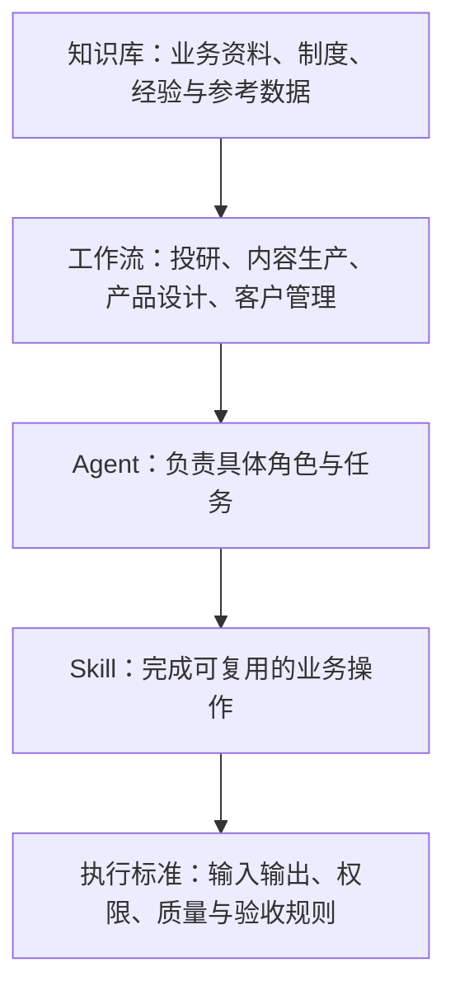
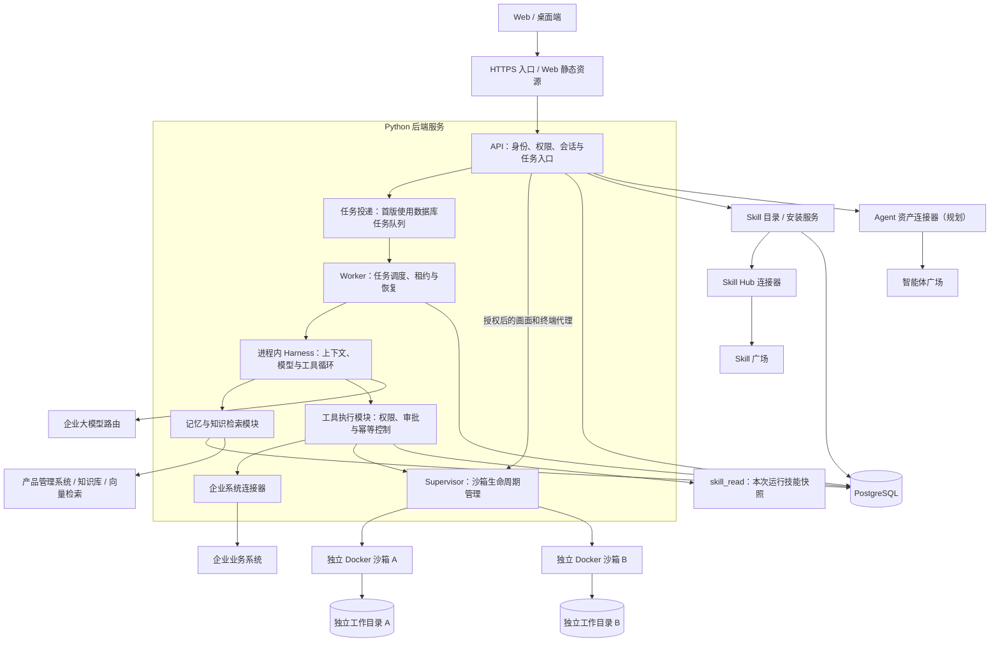

# AgentForge

**智构：基于 Python 的企业级智能体平台。**

AgentForge 致力于连接企业知识、业务工作流、Agent 和 Skill，让智能体在受控环境中完成业务任务。项目采用模块化设计，支持逐步接入已有系统，并以 Python 统一后端开发。

> 当前阶段：Python 后端初始实现。已有 API、Worker、模拟 / Chat Completions Harness、任务持久化和 SQLite / PostgreSQL 测试；下方完整架构仍为建设目标，尚未提供完整平台或生产安装包。

## 文档导航

- [项目架构](docs/architecture.md)：业务分层、运行架构、部署关系、记忆与隔离、五个系统协作及拟定目录。
- [开发路线图](docs/roadmap.md)：实施阶段、验收条件和首个业务闭环。
- [开发入门](docs/development.md)：安装依赖、离线测试、当前接口及实现边界。
- [任务执行协议](docs/task-execution.md)：提交去重、实时进度、断线续传和 Worker 运行方式。
- [PostgreSQL 集成测试](docs/postgresql-testing.md)：独立测试库、临时 schema 隔离与可重复的验证步骤。
- [大模型路由](docs/model-routing.md)：兼容接口配置、工具循环、用量事件与真实联调边界。
- [Agent 与会话](docs/conversations.md)：Agent 版本、消息、执行配置快照、尝试记录及手动调试。
- [版本化工具](docs/tools.md)：工具注册、允许列表、输入输出验证、执行记录和调试。
- [Skill 与广场安装](docs/skills.md)：内置技能、HTTP Hub、版本安装与按需读取。
- [Rakazo 架构对齐](docs/rakazo-alignment.md)：模块映射、已实现边界与后续差距。

架构按 Rakazo 的 API → Worker / Harness → 受控工具 → Supervisor / Computer 职责边界推进；后两者尚未实现。Skill 沿用目录与 skill_read 按需读取模式，支持本地内置与广场安装副本。

## 当前可验证的闭环

创建 Agent → 创建会话 → 提交任务 → 固定配置与历史 → Worker 领取 → 模型与工具循环 → 保存回复 → 查询消息与事件。原有独立任务接口继续可用。

已支持带 `Idempotency-Key` 的重复提交保护、SSE 实时进度与断线续传，以及 Worker 持续消费和租约续期。任务取消或执行失去租约后，旧执行不能写回最终结果。

初版采用 Python 3.12、FastAPI、SQLAlchemy 和 Alembic。默认测试使用临时 SQLite 数据库和进程内 HTTP 客户端，不启动网络服务、容器或真实模型。另提供独立 PostgreSQL 集成测试，已在 PostgreSQL 17.11 上通过验证；生产部署与真实业务仍需单独验收。

macOS 开发联调采用 Colima 的 Docker 运行时承载本地 PostgreSQL，API 与 Worker 在本机运行。已提供 [开发数据库配置](infra/compose/compose.dev.yaml)，默认连接 `127.0.0.1:55432`；Colima 检查、手动启动及联调步骤见 [开发入门](docs/development.md)。开发命令显式使用 `docker --context colima compose`。独立测试配置使用端口 `55433` 和临时存储，详见 [PostgreSQL 集成测试](docs/postgresql-testing.md)。后续 Ubuntu 部署使用 Docker Engine，并可连接已有外部数据库。

安装依赖与执行离线检查：

```bash
uv sync --locked
uv run --locked --offline ruff check .
uv run --locked --offline ruff format --check .
uv run --locked --offline pytest
```

上述命令不启动服务。默认模型模式为 `mock`；已实现可配置的 Chat Completions 路由适配器、多轮工具调用及用量事件，通过模拟 HTTP 响应验证，真实企业路由仍待联调。首版认证只用于本地开发，长期记忆、Docker 沙箱和前端适配尚未实现。

## 项目目标

企业通常已经拥有知识库、智能体管理、技能管理和模型接入等系统。AgentForge 的目标是将这些能力连接起来，形成从任务提交、执行到结果验收的完整流程。

- **模块可组合**：知识、工作流、Agent、Skill、模型和沙箱通过明确的接口协作。
- **后端统一使用 Python**：覆盖 API、任务调度、Agent Harness、记忆、连接器、沙箱管理及业务代理逻辑。
- **复用现有入口**：保留 React 前端和 Electron 桌面端的技术路线，通过接口适配连接 Python 后端。
- **支持私有化部署**：以 Ubuntu、Docker Compose 和独立工具沙箱作为首阶段部署目标。
- **执行过程可管理**：将权限、人工确认、执行记录、资源限制和结果验收纳入任务流程。

## 业务组织模型



知识库为业务流程提供依据；工作流组织多个 Agent 协作；Agent 按任务选择 Skill；每个 Skill 声明输入、输出、所需权限和验收标准。知识资源也可以在执行过程中按权限检索。

## 目标架构



架构图描述目标逻辑职责。API、Worker、Supervisor 计划作为独立后台服务，Harness、Memory、Skill 和 Connector 作为进程内模块；首版任务表兼任持久化队列。Agent 的决策循环运行在 Worker 中，脚本、浏览器和文件操作进入选定的工具沙箱执行。普通聊天和纯业务 API 工具不必启动沙箱。

### 核心模块

| 模块 | 规划职责 |
| --- | --- |
| API | 登录、租户与空间权限、会话、任务提交、结果查询、事件流及授权的画面代理 |
| Worker | 任务领取、并发控制、超时、重试、取消、租约与异常恢复 |
| Agent Harness | 上下文组装、模型调用、工具循环、人工确认和执行状态管理 |
| Memory | 会话摘要、用户与 Agent 记忆、检索、修订和删除 |
| Skill | 内置与已安装技能目录、版本快照、SKILL.md 操作方法与验收要求 |
| Tool | 实际执行动作、参数校验、授权、调用记录及后续审批与幂等 |
| Connector | 接入知识库、智能体与技能资产、模型路由及企业业务 API |
| Supervisor | 创建、连接、停止和回收沙箱，管理资源配额及工作目录 |
| Edge / Web | HTTPS 入口、静态资源、API 转发和长连接转发；业务代理由 Python 实现 |

## 一次任务如何执行

1. 用户从 Web 或桌面端提交任务。
2. API 校验身份和权限，建立任务记录并进入队列。
3. Worker 领取任务并获得租约，为本次执行建立租户、用户、空间、Agent 和任务上下文。
4. Harness 加载相关会话、记忆和知识，调用大模型确定下一步。
5. 工具调用经过权限检查及必要的人工确认，由业务连接器或 Docker 沙箱执行。
6. 执行过程持续回传进度；任务结束后保存结果、产物和执行记录。
7. 需要长期保留的信息按明确范围写入记忆，供后续任务使用。

任务状态和产物需要持久化，人工确认等待期间释放 Worker 执行占用。重试通过幂等标识控制；对结果不确定的非幂等外部操作，先查询结果或人工处理，不自动重复执行。

## 记忆与隔离设计

记忆由服务端持久化，并在任务执行时按授权范围读取。不同类型的信息采用不同的访问范围：

| 信息类型 | 规划范围 |
| --- | --- |
| 会话历史与摘要 | 当前租户、空间、会话及资源权限 |
| Agent 记忆 | 当前租户、空间、所有者和 Agent |
| 用户级记忆 | 当前租户、空间和用户 |
| 团队共享知识与记忆 | 同一租户内显式授权的空间成员和 Agent |
| 工具产物与工作文件 | 对应业务权限边界下的沙箱和存储目录 |

服务端负责确定并校验 `tenant_id`、`space_id`、`user_id`、`agent_id`、`thread_id`、`run_id` 和 `attempt_id`，将范围约束贯穿任务、检索、工具调用与结果读取。租户代表企业或客户边界，单企业部署也保留该维度。历史内容和记忆作为参考数据使用，不授予额外权限。

Worker 可以承接多个用户的任务，提供应用层逻辑隔离，不等于每用户独立进程。不同权限域使用独立 Computer 沙箱、目录和凭据范围；共享需显式授权。API、Worker 和 Computer 不直接获得 Docker socket，Docker 管理权限集中在内部 Supervisor。容器仍共享宿主机；对隔离要求更高的客户，需评估独立部署或虚拟机边界。

## 与现有企业系统协作

AgentForge 通过适配器接入已有系统。以下为规划协作关系，不表示集成已完成。

| 现有系统 | 与 AgentForge 的协作方式 |
| --- | --- |
| 产品管理系统 | 提供产品资料、知识库、向量检索及其访问权限 |
| 智能体广场 | 提供可选 Agent 定义、角色配置和发布版本 |
| Skill 广场 | 提供技能目录、接口描述、版本和执行标准 |
| 大模型路由 | 提供统一模型入口和可用模型能力 |
| AGENT 桌面端 | 提交任务、展示进度、处理人工确认及查看结果 |

企业公共知识与用户个人记忆分别管理，检索时共同遵守访问权限。

## 技术与部署方向

| 层级 | 技术方向 |
| --- | --- |
| 后端业务与 Agent 运行时 | Python |
| Web 页面 | React / TypeScript |
| 桌面客户端 | Electron |
| 结构化数据 | PostgreSQL |
| 知识与语义检索 | 对接已有向量库或检索服务 |
| 工具执行环境 | Docker 沙箱 |
| 首阶段部署 | Ubuntu + Docker Compose |

初版选用 FastAPI、SQLAlchemy、Alembic 和数据库任务队列，Harness 支持模拟模式和 Chat Completions 模式，工具仍限定为无外部副作用的内置报告工具。真实路由兼容性、队列扩容及企业认证在后续闭环中验证。

生产部署目标为后台容器化、工具沙箱独立运行。数据库、记忆和工作文件使用持久化存储；测试与生产采用独立配置和数据。后续交付将包含版本固定、健康检查、备份、升级和恢复流程。

前端与桌面端的复用需要验证登录、API、流式事件及沙箱画面协议。现有 Pi 运行时和后端回调需通过 Python 实现或适配替换。

## 开发路线图

阶段划分与验收要求见 [开发路线图](docs/roadmap.md)。以下先列当前基础实现，再列完整平台的后续事项。

- [x] 建立 Python 工程骨架、API、单次 / 持续运行 Worker 和离线测试。
- [x] 实现按租户、空间、用户范围访问的任务与事件存储。
- [x] 验证模拟模型、内置工具、取消、租约和中断恢复。
- [x] 增加提交去重、租约续期和可断线续传的任务事件流。

- [ ] 定义服务接口、事件协议、数据模型和身份传递规则。
- [x] 建立 Python API、Worker、数据库和基本会话流程。
- [ ] 打通单个 Agent 的模型调用、工具执行与流式输出。
- [ ] 接入 Docker 沙箱，实现资源限制、持久化和任务取消。
- [ ] 完成记忆读写、会话摘要、权限过滤和隔离测试。
- [ ] 接入企业模型路由、知识资源、智能体及 Skill 资产。
- [ ] 适配 React 前端与 Electron 桌面端。
- [ ] 完成人工确认、审计、重试幂等及异常恢复验证。
- [ ] 提供部署文档、安装包和升级恢复流程。

首个里程碑：用户提交任务后，Agent 能在授权范围内调用模型、执行一个沙箱工具，并将结果和执行记录返回页面。

## 开发与贡献

项目处于早期开发阶段。先按 [开发入门](docs/development.md) 完成离线验证；其中另列了后续手动调试命令，不需要为了运行测试而启动服务。

欢迎通过 Issue 讨论真实业务场景、模块接口、部署要求和问题复现方式。较大改动应先明确范围及兼容性；涉及权限、任务恢复和工具执行的修改应包含对应验证。

## 与 Rakazo 的关系

AgentForge 参考 [Rakazo](https://github.com/elie222/rakazo) 的产品形态以及 Agent 运行时与 Computer 沙箱分离的设计，计划复用或适配前端、桌面交互，并使用 Python 重建后端服务。

AgentForge 是独立项目，不是 Rakazo 的官方 Python 版本。Rakazo 的上游许可证见 [Apache License 2.0](https://github.com/elie222/rakazo/blob/main/LICENSE)。实际复用的代码将保留相应的来源和许可证信息。

## 许可证

AgentForge 采用 [MIT License](LICENSE)。

第三方代码和依赖遵循各自的许可证；本项目的 MIT 声明不替代其原有许可证。
