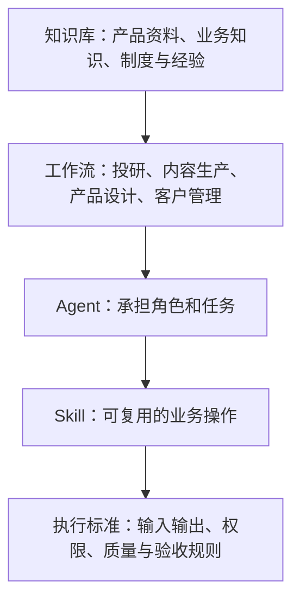
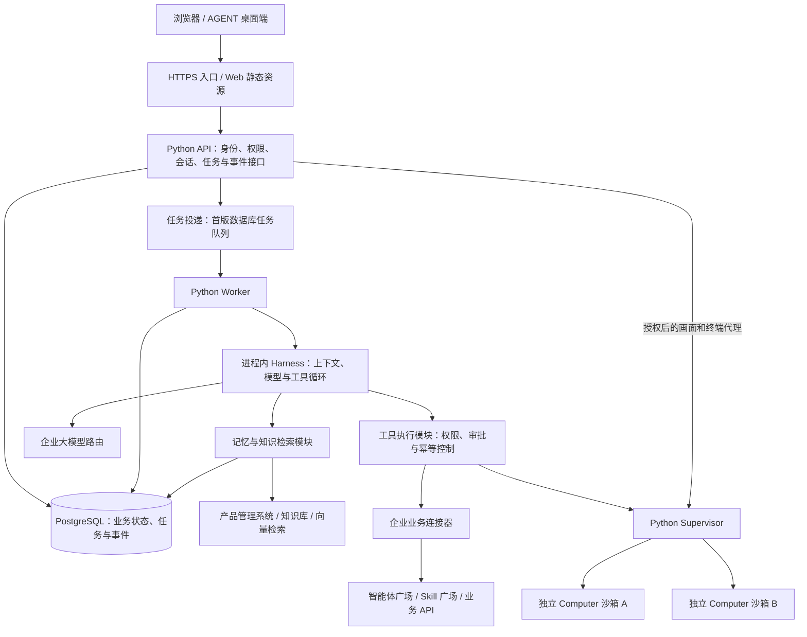
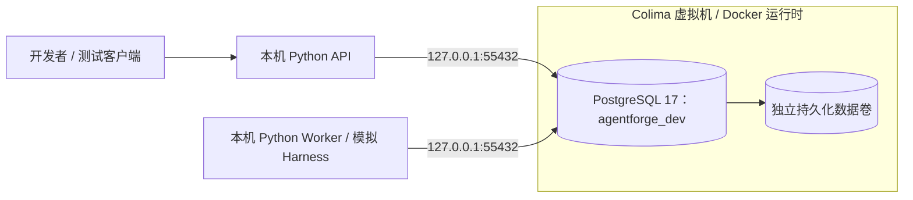
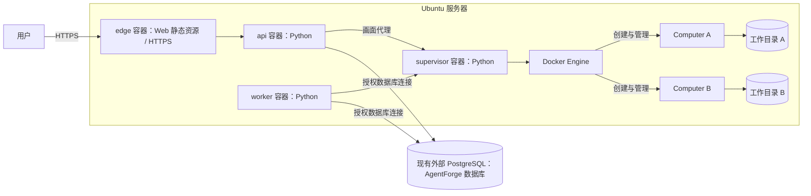
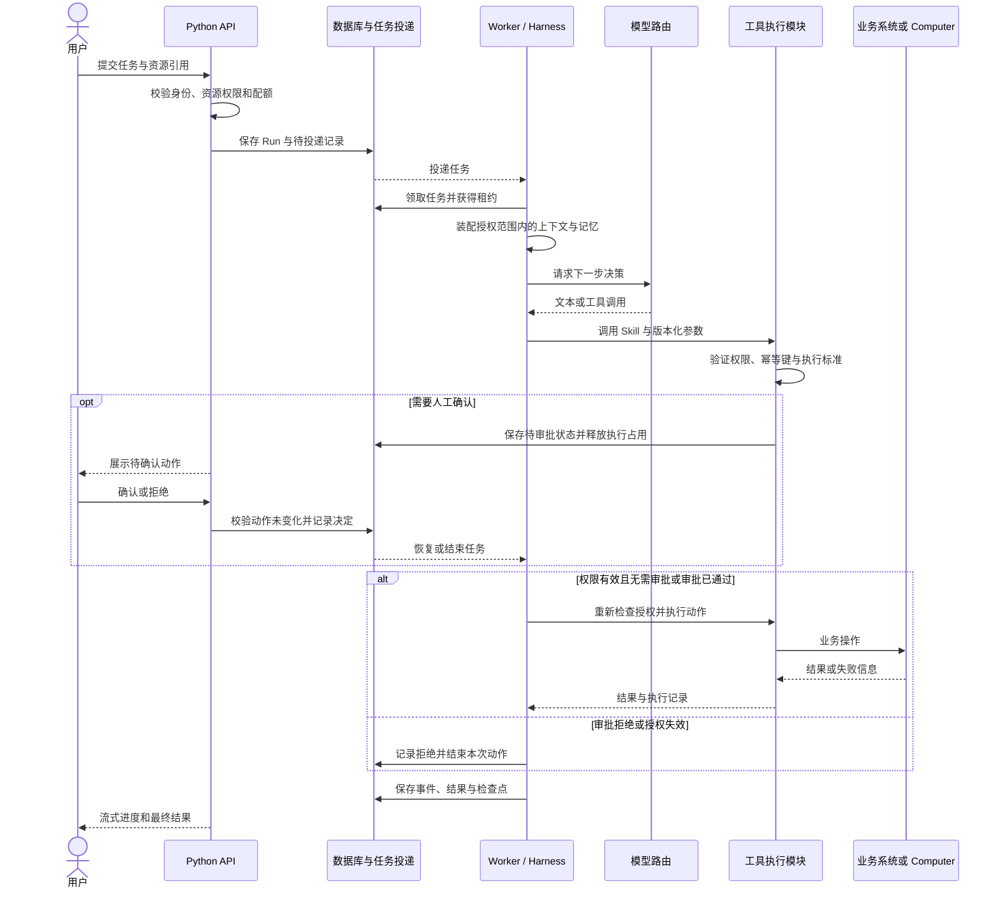

# AgentForge 项目架构

状态：整体目标架构；已建立 Python 离线任务骨架。更新日期：2026-10-28。

本文记录 AgentForge 的技术边界、模块职责和运行约束。README 提供项目概览；后续实现与接口设计以本文为架构基线，实施顺序见 [开发路线图](roadmap.md)。

## 1. 已确定的设计方向

| 范围 | 决策 |
| --- | --- |
| 产品定位 | 企业级、模块化、可私有化部署的 Agent 平台 |
| 业务结构 | 知识库 → 工作流 → Agent → Skill → 执行标准 |
| 后端语言 | API、Worker、Harness、记忆、连接器、沙箱管理及业务代理逻辑统一使用 Python |
| 用户入口 | 保留 React / TypeScript 前端与 Electron 桌面端的技术路线，按新接口适配 |
| 开发环境 | macOS 上 API / Worker 在本机 Python 环境运行，PostgreSQL 由 Colima 的 Docker 运行时承载 |
| 生产部署 | Ubuntu 上使用 Docker Compose，后台容器化，工具在独立 Computer 沙箱运行 |
| 持久化 | PostgreSQL 保存结构化状态；文件使用独立持久化存储 |
| 企业集成 | 接入已有产品管理、智能体广场、Skill 广场、大模型路由和 AGENT 桌面端 |
| 项目许可 | 项目采用 MIT；复用的第三方代码保留其来源与许可证信息 |

“后端统一 Python”针对自研业务服务。Docker、PostgreSQL、浏览器和入口代理继续使用现有基础组件；前端构建工具也不属于 Python 后端。

当前已有 Python API、单次 / 持续运行 Worker、模拟 Harness、任务与事件存储及离线测试。已实现按身份范围隔离的提交去重、SSE 实时事件续传和后台租约续期。框架采用 FastAPI，数据访问和迁移采用 SQLAlchemy / Alembic；任务表兼任持久化队列。具体范围见 [开发入门](development.md) 和 [任务执行协议](task-execution.md)。

已提供仅包含 PostgreSQL 的本地开发 Compose 配置。完整企业认证、真实模型、记忆、Supervisor、前端及应用部署文件仍未实现。下面的架构图描述整体目标，不能视为所有模块已经可运行；本轮只验证 SQLite 和 Compose 配置，PostgreSQL 仍需实际启动后验证。

## 2. 业务架构



这五层描述业务组织关系。知识可以在任意执行步骤按权限检索；工作流负责步骤、依赖和人工节点；Agent 在授权任务范围内决策；Skill 负责具体能力；执行标准用于约束与验收。

Agent 定义、Skill 定义和工作流定义作为可版本化资产管理。每次运行记录实际使用的版本，发布新版本不应隐式改变已经运行中的任务。

## 3. 运行架构



首阶段采用少量服务加进程内模块的组织方式。Harness、Memory、Skill 和 Connector 不默认拆成独立微服务；它们在 API 或 Worker 中按职责调用。首版队列采用数据库任务表和条件更新领取任务；生产调度、向量检索等仍需进一步验证。

### 服务与模块职责

| 组件 | 首阶段运行位置 | 负责什么 | 关键边界 |
| --- | --- | --- | --- |
| Edge / Web | 入口容器 | HTTPS、静态页面、转发 API 与长连接 | 不承载 Agent 决策，不持有模型凭据 |
| API | Python API 容器 | 身份与授权、资源管理、任务提交、事件流、人工确认、画面与终端代理 | 不执行用户生成的脚本，不访问 Docker socket |
| Worker | Python Worker 容器 | 领取任务、并发控制、租约、超时、重试、取消和恢复 | 默认共享工作池，必须按运行上下文处理权限和配额 |
| Harness | Worker 进程内模块 | 上下文选择、模型调用、工具循环、用量和运行检查点 | 通过工具执行模块发起操作，不直接绕过审批 |
| Memory | Python 进程内模块 | 会话摘要、长期记忆、检索、修订和删除 | 每次访问都带授权范围，不能只依赖提示词隔离 |
| Tool / Skill | Worker 进程内模块 | 参数验证、技能版本、权限检查、审批、工具结果与执行记录 | 业务 API 和沙箱操作均执行相同的授权规则 |
| Connector | Python 进程内模块 | 适配企业知识、资产、模型与业务接口 | 不扩大上游资源权限；传递或映射已授权身份 |
| Supervisor | Python Supervisor 容器 | Computer 生命周期、命令与文件接口、画面通道和资源限额 | 唯一需要管理 Docker 的业务服务，仅提供内部受控接口 |
| Computer | 动态 Docker 容器 | 脚本、浏览器、文档及文件处理 | 只挂载本隔离域的工作目录，不挂载 Docker socket 和平台凭据 |

普通聊天和纯业务 API 工具不必启动 Computer；需要命令、文件或浏览器操作时按需分配。

## 4. 开发与服务器部署

### 当前开发环境



开发配置见 [compose.dev.yaml](../infra/compose/compose.dev.yaml)。macOS 上通过 Colima 的 Docker 运行时运行 PostgreSQL，开发命令显式选择 `colima` 上下文；API 与 Worker 保持本机调试。当前没有启动这些组件。自动化离线测试仍使用临时 SQLite 文件，不依赖 Docker。

### 后续 Ubuntu 服务器部署



服务器部署可采用已有外部 PostgreSQL，不新增服务器侧数据库容器。实例地址、数据库用途、账号及 TLS 配置在进入该环境时明确；当前开发先使用本地容器。接入方式见 [开发入门](development.md)。

图中省略了逻辑任务队列和外部模型、知识服务。首版队列复用该数据库，不增加独立队列容器；后续依据负载决定是否调整。

- API、Worker 和 Supervisor 使用内部网络；对外入口集中在 HTTPS 服务。API 与 Worker 通过受控网络访问外部 PostgreSQL，数据库连接信息不传入 Computer 沙箱。
- Supervisor 具备 Docker 管理能力，按高权限控制面维护；API、Worker 和 Computer 不直接获得 Docker socket。
- Computer 按权限边界分配独立工作目录和网络访问策略，配置 CPU、内存、进程数、命令超时及空闲回收策略。
- 数据库、任务事件、记忆和文件独立持久化；重建后台容器不清空这些数据。
- 生产与测试使用不同配置、数据库和数据卷。镜像按固定版本交付，升级前执行备份与兼容性检查。
- API 和 Worker 可横向扩容；扩容前验证任务租约、事件订阅及文件访问方式，不能假定本机目录天然支持多主机部署。

“独立沙箱”首先指独立容器，仍然共享宿主机内核。客户要求进程、数据、凭据和宿主机故障域隔离时，应采用独立部署或虚拟机，并评估相应资源成本。

## 5. 任务生命周期与恢复



一次运行可以包含多轮模型和工具交互。人工确认被拒绝时，不进入工具执行；审批记录只覆盖展示过的参数和动作，不授权后续未确认的操作。

拟定状态为 `queued`、`running`、`waiting_approval`、`waiting_input`、`succeeded`、`failed`、`cancelled`。等待状态需要持久化；再次获准执行时通过任务投递恢复，不长期占用 Worker 槽位。

| 机制 | 实现要求 |
| --- | --- |
| 可靠投递 | 保存任务和投递意图采用事务性发件箱或等效机制，避免数据库写入成功但消息丢失 |
| 任务租约 | 每个执行尝试持有带过期时间和 fencing token 的租约；工具入口与 Supervisor 校验有效租约，拒绝过期尝试的新操作；已经发出的外部操作按不确定结果规则处理 |
| 工具幂等 | 重试沿用同一逻辑操作标识；支持幂等键的外部系统传递该标识 |
| 不确定结果 | 对超时后无法确定是否成功的非幂等操作，先查询结果或转人工处理，不自动重放 |
| 取消 | 状态标记、模型请求中止和沙箱进程终止相互配合；已发生的业务操作不因取消自动撤销 |
| 恢复 | 从持久化状态和检查点恢复；更换 Worker 不能清空会话或重复已确认完成的操作 |
| 事件 | 事件带单调游标与运行标识，客户端支持断线续传和重复事件去重 |

## 6. 记忆与数据权限

### 身份上下文

规划统一的运行上下文：`tenant_id`、`space_id`、`user_id`、`agent_id`、`thread_id`、`run_id`、`attempt_id`。`tenant_id` 标识企业或客户边界，`space_id` 标识其内部协作空间；单企业部署也保留租户维度。

身份与成员关系由服务端依据认证结果解析。客户端提交的资源 ID 需要逐一授权；后台服务使用受限服务身份和绑定任务的执行上下文，不接受模型生成的身份字段作为授权依据。

### 记忆分层

| 类型 | 持久化位置 | 访问条件 |
| --- | --- | --- |
| 会话消息与摘要 | PostgreSQL | 当前租户、空间、会话及资源权限 |
| Agent 长期记忆 | PostgreSQL，按需建立检索索引 | 当前租户、空间、所有者及 Agent |
| 用户长期记忆 | PostgreSQL，按需建立检索索引 | 当前租户、空间、用户 |
| 团队共享记忆 | PostgreSQL 或授权的企业知识系统 | 空间成员关系及显式共享权限 |
| 文件与执行产物 | 持久化文件存储 | 对应资源权限和沙箱隔离域 |

知识库承担企业资料管理，长期记忆承担用户偏好和工作经验，两者通过明确范围关联。检索索引至少保留租户、空间、所有者和共享范围元数据；检索结果在进入模型上下文之前完成权限过滤。

每次运行组合当前任务、近期历史、历史摘要和相关记忆，按上下文预算裁剪。长期记忆通过明确写入流程保存并记录修订；普通对话落库不等于自动写入所有 Agent 的长期记忆。记忆更新、删除和索引刷新需要保持一致。

### 隔离边界

- 共享 Worker 依靠服务端权限与数据访问规则实现逻辑隔离，不提供每用户独立进程或独立内存边界。
- 共享记忆与共享 Computer 必须显式配置；不能仅凭同属一个平台就共享。
- 不同权限域使用独立 Computer、工作目录和凭据范围；多个 Bot 的子目录不是安全边界。
- 增加 Worker 副本只增加处理能力，不自动实现用户或租户绑定。
- 租户专用 Worker 需要同时约束队列路由、数据库权限、凭据和存储访问，不能只增加容器数量。
- API、任务恢复、记忆检索、文件下载、画面访问和工具调用均需覆盖越权验证。

## 7. 现有五个系统的协作关系

这些系统目前相对独立，下表为计划接入关系。

| 系统 | 继续负责 | AgentForge 负责 |
| --- | --- | --- |
| 产品管理系统 | 产品资产、知识资料、向量索引、资源原始权限 | 通过连接器按身份检索并记录来源 |
| 智能体广场 | Agent 定义、角色、版本和发布目录 | 将定义实例化为运行任务，记录使用版本 |
| Skill 广场 | 技能目录、版本、输入输出及执行标准 | 工具注册、参数验证、授权执行和结果验收 |
| 大模型路由 | 模型接入、路由策略、模型能力和上游访问 | 传递任务所需模型请求并记录运行用量 |
| AGENT 桌面端 | 用户交互、任务入口、进度和人工确认 | 提供认证、任务、事件和沙箱访问接口 |

上游系统是资产的管理来源。AgentForge 如需缓存定义，应记录外部 ID、版本和同步状态，不建立隐式的双向修改关系。

## 8. 接口与前端适配

目标接口采用版本化 HTTP / JSON，任务进度使用可续传事件流，交互式终端与桌面画面按需采用 WebSocket 等通道。具体路由和字段在接口设计阶段确定。

React 页面与 Electron 容器可继续沿用，但现有 Rakazo 客户端涉及 oRPC、登录 Cookie、流式事件和画面代理协议，需要兼容适配或修改数据访问层。不能假定替换后端后前端无需调整。

旧 Web 服务中的业务代理逻辑迁入 Python API 或 Python 代理模块；入口容器保留静态资源和通用反向代理。保留通用代理组件不意味着继续保留 Node.js 业务后端。

接口契约至少覆盖：

- 身份与空间：登录、退出、会话、成员身份及权限错误。
- 资产：Agent、Workflow、Skill、知识资源引用及版本。
- 任务：提交、状态、取消、恢复、人工确认和事件游标。
- 记忆：范围、查询、写入、修订和删除。
- 文件与 Computer：产物下载、授权的终端和画面通道、连接失效处理。
- 运维：存活、就绪、版本与内部运行指标。

## 9. 拟定代码组织

以下目录已创建骨架。API、Worker、contracts、core、runtime、storage 和 migrations 包含初始实现；其余模块保留职责说明，尚无实现。模块不因单独列出目录就必须成为独立部署服务。

```text
AgentForge/
├── apps/
│   ├── api/                 Python API 入口
│   ├── worker/              Python Worker 入口
│   ├── supervisor/          Python 沙箱管理入口
│   ├── web/                 React 页面
│   └── desktop/             Electron 客户端
├── packages/
│   ├── contracts/           协议与数据结构
│   ├── core/                领域模型、身份与权限
│   ├── runtime/             Python Agent Harness
│   ├── memory/              记忆与上下文
│   ├── skills/              技能及执行标准
│   ├── connectors/          企业系统适配
│   ├── storage/             数据访问与文件存储
│   └── observability/       事件、日志、用量与审计
├── infra/
│   ├── compose/             部署配置
│   └── computer/            工具沙箱镜像
├── migrations/              唯一的数据库迁移入口
├── tests/                   协议、隔离及端到端验证
├── docs/
│   ├── architecture.md
│   ├── roadmap.md
│   ├── development.md
│   └── task-execution.md
├── pyproject.toml           Python 项目配置及包映射
├── uv.lock                  依赖版本锁定
├── alembic.ini              数据库迁移配置
├── README.md
└── LICENSE
```

首版采用单一 Python 发行包，根目录 `pyproject.toml` 显式映射 `agentforge_api`、`agentforge_worker`、`agentforge_core`、`agentforge_contracts`、`agentforge_storage` 和 `agentforge_runtime`。前端目录暂为说明占位，后续代码继续使用 JavaScript / TypeScript。

## 10. 迁移边界与待验证选型

Rakazo 提供产品形态、运行链路和界面交互参考。现有 Pi 是 JavaScript / TypeScript 依赖，不能直接作为 Python 进程内组件；Python Harness 需要自行实现或选择兼容运行时。

| 待确定事项 | 验证依据 |
| --- | --- |
| FastAPI 企业认证与协议适配 | 现有开发认证仅映射固定身份，已提供 SSE 任务事件；待验证企业登录、前端适配与 WebSocket 代理 |
| 数据库队列的生产调度 | 已有领取、续租、取消和持续消费；待验证 PostgreSQL 并发、真实长任务和容量 |
| Python Agent 运行时 | 初版为模拟模型和一个内置工具；待接入真实模型路由、工具循环、审批和用量统计 |
| SQLAlchemy / Alembic 的生产验证 | 初版已通过 SQLite 迁移；待验证 PostgreSQL 事务、权限及升级流程 |
| 语义记忆与知识接入 | 既有向量库接口、权限过滤、删除同步和召回质量 |
| 前端复用方式 | 旧接口兼容层与前端数据层改造的实际成本 |
| 服务器资源配置 | 实际 Ubuntu 版本、CPU 架构、内存、磁盘、网络及并发任务样本 |

先验证一个真实业务任务的完整链路，再确定依赖和扩容方案。当前不承诺与 Rakazo 的所有功能等价，也不将架构文档视为生产验收结果。

参考：[Rakazo](https://github.com/elie222/rakazo)、[Computer runtime](https://github.com/elie222/rakazo/blob/main/docs/computer-runtime.md)。
