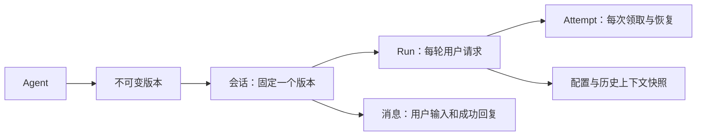

# Agent、会话与执行快照

本阶段增加版本化 Agent、持久化会话和消息、执行尝试，以及提交时确定的运行配置。认证仍为开发令牌；长期记忆、企业登录、工具审批和 Docker 执行尚未实现。

## 数据关系

- Agent 更新时创建新版本，客户端必须提交 `expected_version`；版本冲突返回 409。
- 会话创建时绑定 Agent 当前版本。更新 Agent 不会修改旧会话，采用新版时新建会话。
- 一段会话只允许一个排队或执行中的 Run，其他新提交返回 409。成功、失败或取消后可继续提交；进程崩溃后由现有租约恢复机制接管。
- 提交事务同时保存用户消息、Run、配置和入队事件；成功事务同时保存助手回复、Attempt 结果、Run 和最终事件。失效执行不能补写回复。
- 取消和失败保留用户消息并附带 Run 状态，不伪造助手回复。它们不会进入后续模型历史。
- 模型上下文使用最近 20 个成功完整轮次（40 条消息），在提交时冻结；完整历史仍可分页读取。总上下文超过现有运行限制时任务失败，目前不自动摘要。
- 模拟模式可验证会话存储，但不会理解历史或角色指令；上下文传入已通过模拟 HTTP 的 Chat Completions 测试验证，真实模型仍需联调。

## 执行配置

每个新 Run 保存 `execution_config`：协议版本、Harness 版本、模型协议/名称/路由指纹、超时/轮数/输出上限、Agent 指令和所选工具版本。`agent_id`、`agent_version` 和 `thread_id` 单独记录。已有内置工具注册表、部署级允许列表和调用记录，已增加内置 Skill、Hub HTTP 适配、安装副本与绑定，真实广场待联调，详见 [版本化工具](tools.md) 和 [Skill 安装](skills.md)。

API 读取模型名称、地址和限制，用于生成配置；不需要读取模型密钥。Worker 使用本机配置中的密钥访问同一路由。密钥及原始路由地址不写入快照或响应。API 与 Worker 应使用一致的模型协议、路由地址配置；地址去除末尾 `/` 后计算指纹。

Worker 的默认模型或限制改变时，已有任务仍使用快照。密钥可以轮换；路由指纹不匹配时返回 `model_configuration_mismatch`，不会改投其他路由或静默使用模拟结果。模拟任务始终使用模拟模式。当前为单路由配置，多路由凭据目录留待后续。

任务恢复复用配置和上下文，但仍从头执行模型循环，可能重复请求和计费；本阶段没有工具检查点或外部业务操作幂等保障。

## 接口

所有接口沿用 Bearer 认证，租户、空间、用户由服务端解析，其他范围的资源统一返回 404。

| 方法与路径 | 请求 / 用途 |
| --- | --- |
| `POST /api/v1/agents` | `{"name":"报告助手","instructions":"用中文整理资料"}` |
| `PUT /api/v1/agents/{id}` | 同创建字段，另加 `expected_version`；创建新版本 |
| `GET /api/v1/agents/{id}?version=1` | 查看指定版本；省略 version 查看最新 |
| `GET /api/v1/agents?offset=0&limit=100` | 当前身份的 Agent 列表 |
| `POST /api/v1/threads` | `{"agent_id":"UUID","title":"资料分析"}` |
| `GET /api/v1/threads?offset=0&limit=100` | 当前身份的会话列表 |
| `GET /api/v1/threads/{id}` | 绑定的 Agent 版本及 active_run_id |
| `POST /api/v1/runs` | `{"thread_id":"UUID","prompt":"请整理资料"}`；不传 thread_id 保持独立任务用法 |
| `GET /api/v1/threads/{id}/messages?after=0&limit=100` | 消息及 run_status，返回 next_cursor |
| `GET /api/v1/runs/{id}/attempts` | 执行尝试编号、状态、时间与错误码 |

Agent / 会话列表按创建时间、ID 排序，以 offset 分页；消息与运行事件使用各自游标。`Idempotency-Key` 仍在身份范围内唯一，请求匹配包含 prompt 和 thread_id；重试复用原来的配置，不受默认配置变更影响。Agent 和会话创建暂不提供提交去重。

## 手动调试顺序

先按 [开发入门](development.md) 配置本地数据库和开发令牌；这份说明不会自动启动服务。

1. 执行 `uv run --env-file .env --locked alembic upgrade head` 升级到最新迁移（当前 `0005`）。
2. 按开发入门启动 API，访问 `http://127.0.0.1:8000/docs`，用开发 Bearer 令牌授权。
3. 创建 Agent，记录 agent_id；创建会话，记录 thread_id。
4. 向会话提交第一条 Run，执行 `uv run --env-file .env --locked agentforge-worker --once`，查询消息，预期为一条用户消息和一条助手回复。
5. 提交第二条 Run，再执行 Worker，查询消息，预期共有四条。Chat Completions 模式会把前一轮成功消息作为上下文。
6. 使用相同 Idempotency-Key 重试相同提交，确认 run_id 和消息数量不变；第一条任务未结束时提交不同任务，预期 409。
7. 更新 Agent 到第二版，旧会话仍绑定第一版；新建会话绑定第二版。
8. 查询 attempts，检查成功、取消和恢复后的记录；事件流和原有取消接口继续有效。

真实路由调用须使用已授权的配置和非敏感测试输入，详见 [模型路由](model-routing.md)。

## 升级边界

迁移 `0003` 新增五张表和 Run 字段，不删除既有任务或事件，也不推测历史消息和执行尝试。旧 Run 的快照为 NULL；已结束的历史仍可查询，未结束的旧 Run 被领取后以 `execution_config_missing` 失败，不推测原模型继续执行。需要继续旧任务时，以已确认的新配置重新提交。

数据库升级不代表业务服务已部署。完整验证记录见 [PostgreSQL 集成测试](postgresql-testing.md)。

## Skill 绑定

Agent 创建和完整更新可提交 `skills` 引用列表，默认空列表。服务端解析内置或当前身份已安装的指定版本，保存完整内容与摘要；Run 沿用 Agent 的技能快照。Harness 先提供目录，模型通过 `skill_read` 读取正文。新版本安装或卸载目录项不会改写既有快照；选用新版需更新 Agent 并创建新会话。详情见 [Skill 安装](skills.md)。
