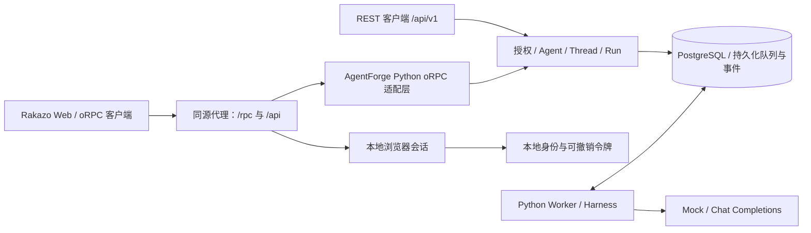

# Rakazo oRPC 接入

更新日期：2026-11-02。对齐已核查的 Rakazo `d165de43`、`@orpc/client 1.15.0` 与其原始契约，未承诺跟随远程最新版本。

本轮采用 **Python 后端兼容 oRPC**。Rakazo Web 保留原客户端调用方式，AgentForge 增加 `/rpc` 协议入口；REST `/api/v1` 继续存在，两者直接复用存储授权、事务、队列和 Worker，不增加 HTTP 自调用或第二套执行引擎。



原版 oRPC / Better Auth 客户端互通及 Rakazo Web 核心聊天页面已经过验证。本轮在 Rakazo 原仓库接入令牌登录，保留全部原有业务入口和自动请求，增加未接通功能的错误提示，保留现有聊天组件与原许可证；没有把其源码复制到本仓库。页面测试使用临时 SQLite、测试身份和 Mock 模型；未迁移开发库，未连接真实模型或企业 SSO。完整 Rakazo 产品功能仍不在兼容范围内。

## 兼容范围

| 调用 | 当前行为 |
| --- | --- |
| `health`、`me`、`bootstrap`、`spaces.list` | 当前已授权空间、身份、助手导航和会话快照；不支持跨空间切换 |
| `bots.list`、`bots.get` | 当前可见 Agent 映射为 Bot |
| `bots.create` | 原子创建 Agent、展示配置及当前用户的 RPC 会话；spawnKey 支持提交去重 |
| `bots.update` | 所有者更新名称、指令及部分展示配置；生成 Agent 新版本 |
| `threads.head`、`threads.get` | 会话游标、消息、最新 Run 和活动 Run |
| `threads.messages` | 按会话事件序号向前分页，每页最多 50 条消息 |
| `threads.send` | 创建 Run，返回 runId、兼容 taskId 及用户消息事件序号；clientNonce 支持幂等 |
| `threads.stop` | 取消当前用户在该会话中的活动 Run |
| `threads.subscribe` | oRPC SSE，跨多轮 Run 保持订阅；支持 Last-Event-ID 和 cursor 续传 |
| 分组、归档列表、分区、定时任务、模型列表及凭据列表 | 只读入口返回空集合，表示这些能力尚未提供 |
| 其余 RPC 操作 | 返回 HTTP 501 / NOT_IMPLEMENTED，不伪造成功 |

支持普通 JSON 请求和文本消息；不支持附件、提及、原生类型序列化元数据、multipart、批处理、RPC GET、Computer、长期记忆、人工审批、语音、分组、独立 Task 或前端模型凭据配置。未知参数和不支持的输入会被拒绝。模型按 AgentForge 后端配置执行，前端模型列表为空。

`GET /api/agentforge/capabilities` 提供 chat、browserLogin、computer、attachments、memory、approvals 等能力标记。调整后的 Rakazo Web 在登录能力标记确认后读取该入口，识别后端并校验协议；读取失败时显示重试。各功能能力标记仅说明后端实现状态，不用于隐藏或禁用业务入口。连接原 Rakazo 后台时保留原界面。

## 领域映射与差异

| Rakazo | AgentForge | 约束 |
| --- | --- | --- |
| Bot | Agent + AgentVersion + rpc_bot_profiles | 展示配置单独保存，执行配置继续版本化 |
| Bot 的聊天 Thread | 按租户 / 空间 / 用户 / Agent 确定的固定 RPC Thread | 共享 Agent 的不同使用者有自己的历史；不会选取其他人的会话 |
| Thread messages | 已有 messages + thread_events | RPC 创建的数据也可通过 REST 查询 |
| Run | 已有 Run | succeeded 映射为 completed；排队、执行、失败、取消保留对应状态 |
| taskId | 基于 Run ID 生成的稳定兼容标识 | 当前没有独立 Task 表或 Task 查询接口 |
| ProductEvent.seq | thread_event_heads / thread_events | 跨多轮运行单调增加，独立于 REST 的 Run 内事件序号 |

**版本行为：** `bots.update` 不会修改已存在 RPC 会话绑定的 Agent 版本。已有会话继续使用旧版指令、技能和工具；采用新版目前可通过 REST 新建会话，但它不会自动替换固定 RPC 会话。`threads.clear` / 新会话切换尚未实现，页面端需在后续阶段补齐该操作。助手设置编辑入口现已恢复；保存设置不代表当前对话切换版本。后端不支持的设置字段会返回 422，未实现的操作返回 501。创建助手时仍可设置名称、标题和描述。

已有 REST 会话及消息继续保留；迁移会回填消息事件，但 RPC 不会自动将任意旧 REST 会话选为当前 Bot 的聊天。共享 Agent 被撤回后，RPC 不再暴露其 Bot 入口；用户自己的历史仍遵守 REST 原有授权规则。

## 请求与事件协议

参考 [oRPC RPC 协议](https://v1.orpc.dev/docs/advanced/rpc-protocol)。核心调用使用 POST `/rpc/<过程路径>`，例如 `/rpc/threads/send`：

```json
{"json":{"botId":"<Agent UUID>","text":"生成一份示例报告","clientNonce":"manual-round-1"}}
```

成功响应为 `{"json": ...}`；错误保留相应 HTTP 状态，例如：

```json
{"json":{"defined":false,"code":"UNAUTHORIZED","status":401,"message":"Invalid or expired credentials"}}
```

SSE 的 `event: message` 数据同样带 `json` 封装；流内错误为 `event: error`。事件包括用户 / 助手消息、运行开始 / 完成 / 失败 / 取消、工具调用 / 完成和模型用量；当前没有逐 token 输出。流不因某次 Run 结束而关闭，可继续接收下一轮消息。

游标由数据库原子递增，和状态、消息在同一事务中提交。`Last-Event-ID` 优先于输入 cursor；无效或超前游标报错。空闲期间每 15 秒发送注释心跳，等待不占用数据库连接；批内每条事件发送前复查凭据、成员与 Agent 可见性。

## 浏览器登录与权限

首次联调使用本地访问令牌交换浏览器会话。它不是 Rakazo 原后台的密码认证，也不是企业 SSO；无需同时运行两套登录后台。

- `AGENTFORGE_AUTH_MODE=database` 且配置 `AGENTFORGE_WEB_ORIGIN` 时才启用。
- 登录页：`GET /api/auth/agentforge`；输入已签发的本地访问令牌。
- `POST /api/auth/agentforge/sign-in` 交换 HttpOnly / SameSite=Strict Cookie；HTTPS 来源使用 Secure。
- `/api/auth/get-session` 与 `/api/auth/sign-out` 兼容原版 Better Auth 客户端的会话读取和退出。
- 会话最长 8 小时，并受原令牌有效期限制；数据库只保存摘要。每次访问重新检查原令牌、成员和资源权限；退出仅撤销当前浏览器会话。
- Cookie 认证的 RPC 请求及登录、退出必须携带精确匹配的 Origin；前端代理 `/api` 与 `/rpc`，保持浏览器同源。不要通过放宽 CORS 或信任任意空间头绕过校验。
- REST 保持 Bearer 认证；RPC 也接受 Bearer。显式无效的 Bearer 不会回退使用 Cookie。
- `x-rakazo-space-id` 只用来核对当前令牌空间，不赋予空间切换权限。
- 本地用户没有邮箱字段；兼容响应中的 `@agentforge.invalid` 是显示占位且 emailVerified=false，不能用于邮箱验证或用户关联。

调整后的 `/sign-in` 已提供访问令牌表单，并隐藏注册、密码与找回密码入口；登录后清除旧空间选择，退出或凭据失效后回到该页面。`/api/auth/agentforge` 保留作为后端独立入口。密码和企业认证仍未实现。

## 手动联调

以下命令供手动运行，会启动服务或修改指定开发数据库；自动化测试不需要启动它们。所有 AgentForge 命令在其仓库根目录执行。

1. 在原有 `.env` 中合并配置，保留数据库和模型设置：

```dotenv
AGENTFORGE_AUTH_MODE=database
AGENTFORGE_WEB_ORIGIN=http://127.0.0.1:5173
AGENTFORGE_MODEL_PROVIDER=mock
```

Origin 不带路径或末尾斜杠；`localhost` 与 `127.0.0.1` 不可混用。API 与 Worker 使用相同认证模式、数据库、模型和工具配置。

2. 显式升级到 `0007`：

```bash
uv run --env-file .env --locked alembic upgrade head
```

`0007` 新增 rpc_bot_profiles、thread_event_heads、thread_events、browser_sessions，为已有消息回填会话事件，不自动初始化身份、不覆盖已有消息。首次使用 database 模式时，按 [本地身份与权限](identity.md) 初始化空间 / 管理员并签发令牌；已有空间不要重复初始化。

3. 分别在两个终端启动 API 和 Worker：

```bash
uv run --env-file .env --locked uvicorn agentforge_api.app:create_app --factory --host 127.0.0.1 --port 8000
```

```bash
uv run --env-file .env --locked agentforge-worker --watch
```

4. 在已完成依赖安装的 Rakazo 仓库中，将 Web 代理指向 AgentForge：

```bash
NODE_ENV=development API_PROXY_TARGET=http://127.0.0.1:8000 WEB_PORT=5173 pnpm --filter @rakazo/web dev
```

保留 Rakazo 自身的 Web 构建配置。其 Vite 配置还会初始化画面代理，需要符合 Rakazo 要求的 `SCREEN_PROXY_SECRET`（独立随机值，不同于认证和 Supervisor 凭据）；此配置不表示 AgentForge 已提供 Computer。不要同时启动 Rakazo 原 API / Worker 来处理这组请求。缺少依赖或构建配置时先按 Rakazo 自身说明准备，本轮没有改写其环境文件。

5. 打开 `http://127.0.0.1:5173/sign-in`，输入本地令牌，进入 `/app`。页面会清除旧空间选择；直接使用后端独立登录页时，仍需自行处理浏览器中原 Rakazo 的旧空间选择。

6. 首轮页面验收只验证：助手列表 → 创建普通文本助手 → 发送文本 → Worker 执行 → 完成回复 → 第二轮 → 刷新后历史保留 → 取消 → 退出。电脑、附件、语音、集成、分组、搜索、活动、归档、模型设置、技能管理和看板等原有业务入口全部保留，其自动请求恢复；直接链接进入原页面。页面提供可展开的错误提示，列出失败接口和状态码；相同接口的轮询错误去重，最多保留 20 项，重试成功后移除。提示不显示请求参数、响应正文或凭据。若看到 501，应按上表检查接口范围；这表示入口可联调，并不代表后端功能已实现。默认 Mock 返回示例工具结果，不代表真实模型输出。

调试时重点查看浏览器 `/api/auth/get-session`、`/rpc/bootstrap`、`/rpc/threads/send` 和 `/rpc/threads/subscribe`。401 检查令牌 / 会话；403 检查 Origin、空间和角色；409 检查活动 Run、clientNonce 或游标；503 检查迁移、认证配置和存储连接；501 表示功能待实现。

## 自动化验证

默认离线回归仍使用临时 SQLite 和模拟模型：

```bash
uv run --locked --offline pytest
```

原版客户端互通测试需要本地 Rakazo 源码及其已安装依赖、Node 和 tsx，不通过网络下载。按本机实际路径设置：

```bash
AGENTFORGE_RAKAZO_ROOT=/path/to/rakazo uv run --locked --offline pytest tests/test_orpc_interop.py
```

测试直接加载 Rakazo 的 oRPC / Better Auth 客户端和 Zod 契约，通过进程内 HTTP 桥接验证请求、响应、两轮发送、重复提交、订阅、错误、会话读取与退出；不打开网页、不监听端口。未设置路径时，这两项明确跳过。它不是 Web 页面端到端测试或性能基准。

PostgreSQL 使用 [独立测试环境](postgresql-testing.md)，也可启用真实客户端测试：

```bash
AGENTFORGE_RAKAZO_ROOT=/path/to/rakazo uv run --env-file .env.test.example --locked --offline pytest --database-backend=postgresql
```

覆盖跨用户隔离、共享 Agent 独立历史、并发首发、幂等、版本固定、分页、SSE 续传与撤权、Cookie 来源校验、迁移回填和投影失败回滚。测试结果见 [PostgreSQL 验证记录](postgresql-testing.md)。没有接入真实模型、真实 Skill Hub 或企业 SSO，也未进行容量压测。

## Web 页面回归

Rakazo 仓库新增 `docs/agentforge-web.md`、`apps/web/playwright.agentforge.config.ts` 与 `apps/web/e2e/agentforge.spec.ts`。本仓库的 `tests/interop/browser_server.py` 仅用于显式启动独立测试服务：绑定本机、创建临时库、生成临时用户，并提供测试端点控制 Worker；生产应用工厂没有这些端点。

分别启动三个终端：

```bash
# AgentForge 仓库；不加载 .env，不连接开发库
uv run --locked --offline python tests/interop/browser_server.py --port 18000 --web-port 15173
```

```bash
# Rakazo 仓库
NODE_ENV=development API_PROXY_TARGET=http://127.0.0.1:18000 WEB_PORT=15173 RAKAZO_DEV_HOST=127.0.0.1 pnpm --filter @rakazo/web dev
```

```bash
# Rakazo 仓库；有已安装 Chromium 时可省略 PLAYWRIGHT_CHANNEL
AGENTFORGE_WEB_E2E=1 PLAYWRIGHT_CHANNEL=chrome pnpm --filter @rakazo/web exec playwright test --config playwright.agentforge.config.ts
```

结束后 Ctrl+C 停止两个测试服务，临时库自动清理。测试验证登录失败提示、旧空间选择清理、两轮对话、刷新历史、取消、退出、双用户隔离、令牌撤销、原页面直接访问、未接通功能报错、能力读取失败重试和中文登录；截图保存于 Rakazo 的 `test-results/agentforge/`（已忽略）。真实模型、长期记忆、Computer、企业 SSO 和生产容量仍需后续单独验收。

本轮验证（2026-11-02）：692 项 Web 单元回归通过，2 项真实浏览器场景通过；类型检查、前端静态检查及生产构建通过。测试 API / Web 已停止，临时数据清理；开发库、真实模型和线上服务未改动。构建保留大资源块提示，尚未做性能压测。
