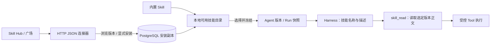

# 本地 Skill 与 Skill Hub 安装

状态：已实现后端目录、安装、绑定与运行时按需读取；未提供管理页面，真实广场待对接。Skill 是可复用的操作说明，Tool 是实际执行动作。Skill 不能自行授予工具权限或安装可执行代码。

## 架构与使用方式

沿用 Rakazo 的“内置与持久化技能合并目录 → 模型查看目录 → skill_read 读取 SKILL.md → 调用受控工具”模式。HTTP Hub 通过独立连接器适配，是本项目对企业广场的扩展。



- 内置“资料摘要”“会议纪要”“文本统计”三个技能，无需网络或安装；在 `packages/skills/agentforge_skills/builtin.py` 维护，变更已发布内容时增加版本。
- 本地目录包含内置技能和当前身份已安装技能。广场列表只用于发现，浏览不自动安装。内置技能默认可选，Agent 的 `skills` 默认空列表，按用途显式绑定。
- 安装把指定版本的 Markdown 正文、元数据、来源指纹和 SHA-256 摘要保存在 PostgreSQL；不解压压缩包、不运行安装命令、不导入 Python 或 Node 代码。
- 新建或更新 Agent 时解析所选技能并冻结完整内容；会话和 Run 沿用该版本快照。运行中通过 `skill_read` 按需读取，不再连接广场。工具调用仍记录在 `tool_calls`。
- 模型最初只看到已绑定技能的名称、描述和引用。`skill_read@1` 是 Worker 为这些快照提供的内部纯读取工具，不能读未绑定技能，也不能安装技能。它不要求配置进业务工具允许列表，且不会开放额外业务操作。
- `required_tools` 只声明需求，不自动授权。绑定技能时须显式选择所需工具，且这些工具必须符合部署允许列表。一个技能可以组合多个工具。
- 更新安装为新版本产生独立安装引用；旧 Agent、会话和 Run 不会自动升级。同一来源和版本的内容变化返回 409。
- 卸载只移除本地目录中的可选项；已有 Agent / Run 的固定副本继续可用。卸载不是权限撤销或任务取消；企业级集中撤销尚待实现。
- 当前安装按租户、空间、用户隔离。认证仍为开发令牌，尚无团队共享安装或企业 RBAC。

当前 mock 模式确定性读取第一个绑定技能，再执行第一个业务工具；没有业务工具时返回明确的模拟回复。它不理解或执行技能说明。真实模型的选择行为需要单独联调。

## 配置

默认不连接 Hub；仅 API 需要以下配置，Worker 不持有 Hub 凭据：

```dotenv
AGENTFORGE_SKILL_HUB_URL=https://skills.example.internal/api/v1
AGENTFORGE_SKILL_HUB_TOKEN=
AGENTFORGE_SKILL_HUB_TIMEOUT_SECONDS=10
```

地址由部署方配置，客户端不能提交下载 URL。令牌非空时以 Bearer 发送；不跟随重定向、不使用环境代理、不中途切换来源。内网 HTTP 可配置，生产应采用部署方确认的 HTTPS 地址。地址和密钥不写入安装记录或运行快照。

## 平台 API

均需现有 Bearer 身份。接口可在 `/docs` 调试。

| 接口 | 用途 |
| --- | --- |
| `GET /api/v1/skills?offset=0&limit=20` | 内置与已安装技能，包含本地正文；返回 next_offset |
| `GET /api/v1/skills/hub?q=&offset=0&limit=20` | 浏览广场版本列表，返回 source_id 和 SHA-256 |
| `GET /api/v1/skills/hub/{skill_id}/versions/{version}` | 安装前预览元数据、正文和摘要 |
| `POST /api/v1/skills/install` | 安装明确的来源、技能、版本和摘要；重复安装复用引用 |
| `DELETE /api/v1/skills/installations/{installation_id}` | 从本身份的本地目录卸载；内置技能不提供此接口 |

安装请求中的值取自列表或预览结果：

```json
{
  "source_id": "hub:<返回的64位来源指纹>",
  "skill_id": "research_summary",
  "version": 1,
  "sha256": "<返回的64位内容摘要>"
}
```

安装响应的 `reference` 为本地 UUID。内置技能使用 `builtin:document_summary@1`、`builtin:meeting_notes@1`、`builtin:text_statistics@1`。

创建带技能的 Agent：

```json
{
  "name": "文本统计助手",
  "instructions": "按用户要求统计文本。",
  "tools": ["text_stats@1"],
  "skills": ["builtin:text_statistics@1"]
}
```

使用广场技能时，将其安装响应中的 `reference` 放入 `skills`。随后创建会话、提交 Run、启动一次 Worker，并查询工具调用记录；真实模型选择技能时可看到 `skill_read`，然后是业务工具。更新 Agent 使用完整配置和 `expected_version`，省略 `skills` 表示新版本不绑定技能。

每个 Agent 最多绑定 8 个不同技能，单个正文最多 12,000 字符，正文合计最多 32,000 字符。不同来源允许同名，以精确 reference 区分；同来源同技能只选一个版本。

## Hub HTTP JSON 对接协议 v1

这是 AgentForge 暂定的连接器协议，不声称已有广场天然兼容。现有广场可在 `packages/connectors/agentforge_connectors/skill_hub.py` 中做字段与协议转换，保持 `SkillHub` 接口不变。

配置地址后追加以下路径：

1. `GET /skills?offset=0&limit=20&q=摘要`，响应 `{"items":[...],"next_offset":null}`。每项包含 `skill_id`、整数 `version`、`name`、`description`、`required_tools` 和 `sha256`，不包含正文。每页上限 50，不同版本可以分别展示。
2. `GET /skills/{skill_id}/versions/{version}`，返回以下完整 manifest，无额外封装：

```json
{
  "skill_id": "research_summary",
  "version": 1,
  "name": "研究摘要",
  "description": "整理用户提供的研究资料",
  "required_tools": [],
  "content": "# 研究摘要\n提取事实、结论和待核实事项。"
}
```

`content` 是 Markdown 正文。运行时 `skill_read` 输出带 `name`、`description` YAML frontmatter 的 SKILL.md 文档；本轮没有实现任意 YAML 文件导入或资源包安装。

内容摘要对包含上述全部字段的规范化 manifest 计算：补齐缺省 `required_tools: []`，对象键排序，保留 Unicode，去掉 JSON 结构空格，然后以 UTF-8 编码计算 SHA-256。对应 `SkillManifest.digest()`；该摘要用于确认版本内容，不是发布者数字签名。

`next_offset` 为下一页起点（当前 offset 加本页数量），无下一页时为 null。返回版本身份必须与请求一致；不接受脚本或安装命令等未声明字段。上游响应解码后最多 512,000 字节，超时默认 10 秒。

未配置/不可用返回 503；非法上游内容返回 502；来源或摘要变化返回 409；未安装、越权或不存在的引用返回 404；无效绑定或缺少工具返回 422。响应不包含上游错误正文或凭据。

## 数据迁移和验证边界

迁移 `0005` 仅增加 `skill_installations`，保留已有 Agent、Run、消息和工具记录。旧快照不含 skills 时按空列表读取，不自动补入内置技能。开发库升级仍需显式执行 `uv run --env-file .env --locked alembic upgrade head`。

自动化测试覆盖离线内置目录、HTTP 模拟广场、安装去重与版本冲突、越权、卸载、快照恢复、按需读取、工具限制及非破坏性迁移。真实广场、真实模型和生产环境未在本轮联调。

## 本轮验证记录（2026-10-30）

- SQLite：231 项通过，5 项 PostgreSQL 专用测试跳过。
- PostgreSQL 17.11：236 项通过，使用独立临时测试库与每用例 schema。
- Ruff 检查及格式验证通过；无新增第三方依赖。
- 测试后的 af_test_ 临时 schema 数量为 0，测试容器和网络已移除。开发库未执行迁移。
- Hub 和模型请求均使用模拟 HTTP；没有接入真实广场、模型或业务系统。
