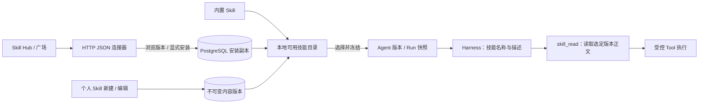

# 本地 Skill 与 Skill Hub 安装

状态：已实现后端目录、安装、绑定与运行时按需读取，并接通原版 Rakazo Skill 浏览和聊天显式选择；个人技能新建、编辑、删除已接通，Hub 管理入口待建设，真实广场待对接。Skill 是可复用的操作说明，Tool 是实际执行动作。Skill 不能自行授予工具权限或安装可执行代码。

## 架构与使用方式

沿用 Rakazo 的“内置与持久化技能合并目录 → 模型查看目录 → skill_read 读取 SKILL.md → 调用受控工具”模式。HTTP Hub 通过独立连接器适配，是本项目对企业广场的扩展。



- 内置“资料摘要”“会议纪要”“文本统计”三个技能，无需网络或安装；在 `packages/skills/agentforge_skills/builtin.py` 维护，变更已发布内容时增加版本。
- 本地目录包含内置技能、当前身份已安装技能及同空间显式共享的安装副本。广场列表只用于发现，浏览不自动安装。内置技能默认可选，Agent 的 `skills` 默认空列表，按用途显式绑定。
- 安装把指定版本的 Markdown 正文、元数据、来源指纹和 SHA-256 摘要保存在 PostgreSQL；不解压压缩包、不运行安装命令、不导入 Python 或 Node 代码。
- 新建或更新 Agent 时解析所选技能并冻结完整内容；会话和 Run 沿用该版本快照。运行中通过 `skill_read` 按需读取，不再连接广场。工具调用仍记录在 `tool_calls`。
- 模型最初只看到已绑定技能的名称、描述和引用。`skill_read@1` 是 Worker 为这些快照提供的内部纯读取工具，不能读未绑定技能，也不能安装技能。它不要求配置进业务工具允许列表，且不会开放额外业务操作。
- `required_tools` 只声明需求，不自动授权。绑定技能时须显式选择所需工具，且这些工具必须符合部署允许列表。一个技能可以组合多个工具。
- 更新安装为新版本产生独立安装引用；旧 Agent、会话和 Run 不会自动升级。同一来源和版本的内容变化返回 409。
- 卸载只移除本地目录中的可选项；已有 Agent / Run 的固定副本保留。卸载不是权限撤销或任务取消；将共享改回 private 会阻止其他成员后续借用及执行，已有副本和历史不作远程删除。
- 安装默认按租户、空间、用户私有；所有者可显式共享到空间，其他成员可绑定，不能替所有者卸载或改共享。viewer 只能读取；角色和撤权规则见 [本地身份与权限](identity.md)。

当前 mock 模式确定性读取第一个绑定技能，再执行第一个业务工具；没有业务工具时返回明确的模拟回复。它不理解或执行技能说明。真实模型的选择行为需要单独联调。

## 原版 Rakazo Web 接入

AgentForge 兼容原版 `agentSkills.list/get`。登录后可在知识设置的 Skills 区域查看技能正文，在聊天输入框输入 `/`，选择技能并发送任务。Rakazo 源码与请求结构保持原样。

- 列表合并三个内置技能、本人安装副本、同空间显式共享副本及本人创建的技能；未安装的 Hub 资产不进入本地目录。列表不包含正文，详情返回 SKILL.md。
- 内置技能映射为 `builtin`，Hub 安装副本映射为原版的 `plugin`，均为只读版本资产。个人技能映射为 `user`，可通过原版 create / update / remove 接口维护；浏览和安装 Hub 继续使用已有 REST 接口，不改写已发布版本。
- 原版聊天通过 `/技能名\n任务内容` 传递选择，也接受 `Use skill: 技能名` 前缀。安装技能的显示名带版本和安装引用的前 8 位，保持同名版本和不同用户安装副本可区分；显示名不超过原版 80 个 UTF-16 字符单元。极少见的短引用冲突按 409 拒绝按名称选择，详情仍可按完整 ID 读取。
- 显式选择的技能与 Agent 原有绑定共同保存到本次 Run，`requested_skill` 记录本次选择的精确 reference。Agent 版本和 REST 会话不因此改变，下一条普通消息不自动继承本次临时选择。单一来源同技能仍只允许一个版本；与已有绑定版本冲突返回 422，不静默替换。
- 在创建 Run 的同一事务内完成目录解析、配置校验和权限复查。按相同 clientNonce 重试，先返回已接受 Run，不重新读取最新目录；卸载、升级和 Worker 恢复不会改变旧快照。共享撤销和成员停用仍会阻止后续执行。
- 技能选择不增加工具权限。缺少 Agent 工具授权、部署禁止工具、超过 8 个技能或 32,000 字符正文预算时返回 422，不产生消息或排队任务。比如“文本统计”需要该 Agent 已显式启用 `text_stats@1`；不能仅凭选择技能自动开启。
- 对识别为显式技能前缀的未知或已卸载名称返回 404，避免旧页面静默使用其他版本。普通消息、原版设置快捷命令和 REST prompt 不进行技能绑定。`@技能名` 的定时任务扩展尚未实现。

示例：在原版输入框选择“资料摘要”，再输入资料。Worker 收到的是原始用户消息、精确技能快照和选择标记，通过现有 `skill_read` 读取正文；不会在 API 中执行技能或在 Worker 中重新访问 Hub。模拟模式只能验证流程与记录，真实效果需接入模型后验收。

Rakazo 的 `skills.*` 是录制操作、示教流程的独立功能，本轮不将它与 `agentSkills.*` 的文档配方混用；相关接口仍返回未实现错误。

## 个人 Skill 创建、编辑和删除

原版知识设置的 Skills 区域可新建个人技能、编辑 SKILL.md 和删除。后端实现 `agentSkills.create/update/remove`，不改 Rakazo 页面；此功能与录制示教的 `skills.*` 不同。角色为 admin / member 的用户可维护自己的技能，viewer 只读。个人技能本轮不提供空间共享，管理员也不能读取或修改他人的私人技能。

- `create` 接收 `content`（带 YAML frontmatter 的 SKILL.md），或 `name` / `description` / 可选 `body`。非空 content 优先。`update` 接收稳定的 skillId 和至少一个内容字段；部分字段更新保留其他元数据。`remove` 接收 skillId。
- 每个用户、空间、租户中的活动名称大小写归一后唯一；内置名称保留。内部空格保留，禁止换行、原版设置快捷命令名称及安装技能的版本后缀。冲突返回 409，内置与已安装 Hub 技能写入返回 403。
- `user_skills` 保存稳定资产 ID 和当前版本；`user_skill_versions` 保存独立 UUID 的不可变内容版本。原版返回的 id 是资产 ID；REST 技能目录中的 reference 是具体版本 ID，可显式绑定 Agent。两者不能混用。
- 编辑生成新版本，相同内容重试不重复增版。原版表单不带版本前置条件，因此同字段并发更新按最终提交生效；后端在事务内串行合并部分字段。其他客户端可传可选 `expectedVersion`，过期返回 409。
- `/技能名` 在新任务提交时固定当前可见版本；旧 Run 和重试仍使用旧版本。已有 Agent 显式绑定的版本也保持不变，升级绑定需要新的 Agent 版本。
- 删除仅移除目录项并释放名称，不擦除历史版本、Agent / Run 的副本，也不取消已经提交的任务。已有拥有者快照仍可执行；成员停用、工具权限撤销等实时策略继续生效。如需停止任务，使用任务取消接口。
- 个人技能的 SKILL.md 全文上限 12,000 字符，frontmatter 上限 4,000，名称上限 80 个 UTF-16 字符单元，描述上限 1,000；这是为保持已有运行上下文预算而保留的限制，比 Rakazo 文档编辑字段的上限更小。返回 422 时不新增版本或任务。
- 使用受限的 [PyYAML SafeLoader](https://pyyaml.org/wiki/PyYAMLDocumentation) 解析标量、列表、映射和多行文字；拒绝重复键、锚点 / 别名、对象标签、过深结构与过多节点。未知元数据按数据保留；评论和格式不保证逐字保留，解析错误不回显文档。
- `required_tools` 可列出版本化工具依赖，例如 `[text_stats@1]`，绑定时校验 Agent 是否已授权。`allowed-tools` 等其他元数据只是文档文字，不安装程序、不增加权限。模型侧自动创建 / 修改技能工具尚未开放。

可粘贴到原版 New skill 编辑器的最小样例：

```markdown
---
name: 事实核对
description: 根据用户给出的材料区分事实、推断和缺失依据
---

只引用已提供的材料；无法核实的内容列入待确认项。
```

测试顺序：创建技能 → 在聊天框选择 `/事实核对` → 发送资料 → 编辑技能 → 再次发送 → 检查两次 Run 的技能版本 → 删除后确认目录消失。模拟模型验证的是流程和读取记录，不代表已评估技能的业务效果。

迁移 `0010` 只增加两张个人技能表，不改变原有聊天、密码和 Hub 安装记录。当前开发库尚未执行此迁移；下次启动前显式执行 `uv run --env-file .env --locked alembic upgrade head`。存在个人技能历史版本时，降级会被拒绝，避免丢失旧任务的依赖；不得将回退旧代码等同于可无损降级数据库。

## 配置

默认不连接 Hub；仅 API 需要以下配置，Worker 不持有 Hub 凭据：

```dotenv
AGENTFORGE_SKILL_HUB_URL=https://skills.example.internal/api/v1
AGENTFORGE_SKILL_HUB_TOKEN=
AGENTFORGE_SKILL_HUB_TIMEOUT_SECONDS=10
```

地址由部署方配置，客户端不能提交下载 URL。令牌非空时以 Bearer 发送；不跟随重定向、不使用环境代理、不中途切换来源。内网 HTTP 可配置，生产应采用部署方确认的 HTTPS 地址。地址和密钥不写入安装记录或运行快照。

## 平台 API

均需现有 Bearer 身份。接口可在 `/docs` 调试。

| 接口 | 用途 |
| --- | --- |
| `GET /api/v1/skills?offset=0&limit=20` | 内置与已安装技能，包含本地正文；返回 next_offset |
| `GET /api/v1/skills/hub?q=&offset=0&limit=20` | 浏览广场版本列表，返回 source_id 和 SHA-256 |
| `GET /api/v1/skills/hub/{skill_id}/versions/{version}` | 安装前预览元数据、正文和摘要 |
| `POST /api/v1/skills/install` | 安装明确的来源、技能、版本和摘要；重复安装复用引用 |
| `DELETE /api/v1/skills/installations/{installation_id}` | 从本身份的本地目录卸载；内置技能不提供此接口 |

安装请求中的值取自列表或预览结果：

```json
{
  "source_id": "hub:<返回的64位来源指纹>",
  "skill_id": "research_summary",
  "version": 1,
  "sha256": "<返回的64位内容摘要>"
}
```

安装响应的 `reference` 为本地 UUID。内置技能使用 `builtin:document_summary@1`、`builtin:meeting_notes@1`、`builtin:text_statistics@1`。

创建带技能的 Agent：

```json
{
  "name": "文本统计助手",
  "instructions": "按用户要求统计文本。",
  "tools": ["text_stats@1"],
  "skills": ["builtin:text_statistics@1"]
}
```

使用广场技能时，将其安装响应中的 `reference` 放入 `skills`。随后创建会话、提交 Run、启动一次 Worker，并查询工具调用记录；真实模型选择技能时可看到 `skill_read`，然后是业务工具。更新 Agent 使用完整配置和 `expected_version`，省略 `skills` 表示新版本不绑定技能。

每个 Agent 最多绑定 8 个不同技能，单个正文最多 12,000 字符，正文合计最多 32,000 字符。不同来源允许同名，以精确 reference 区分；同来源同技能只选一个版本。

## Hub HTTP JSON 对接协议 v1

这是 AgentForge 暂定的连接器协议，不声称已有广场天然兼容。现有广场可在 `packages/connectors/agentforge_connectors/skill_hub.py` 中做字段与协议转换，保持 `SkillHub` 接口不变。

配置地址后追加以下路径：

1. `GET /skills?offset=0&limit=20&q=摘要`，响应 `{"items":[...],"next_offset":null}`。每项包含 `skill_id`、整数 `version`、`name`、`description`、`required_tools` 和 `sha256`，不包含正文。每页上限 50，不同版本可以分别展示。
2. `GET /skills/{skill_id}/versions/{version}`，返回以下完整 manifest，无额外封装：

```json
{
  "skill_id": "research_summary",
  "version": 1,
  "name": "研究摘要",
  "description": "整理用户提供的研究资料",
  "required_tools": [],
  "content": "# 研究摘要\n提取事实、结论和待核实事项。"
}
```

`content` 是 Markdown 正文。运行时 `skill_read` 输出带 `name`、`description` YAML frontmatter 的 SKILL.md 文档；个人技能另支持上文限定的 YAML 导入，未实现资源包安装。

内容摘要对包含上述全部字段的规范化 manifest 计算：补齐缺省 `required_tools: []`，对象键排序，保留 Unicode，去掉 JSON 结构空格，然后以 UTF-8 编码计算 SHA-256。对应 `SkillManifest.digest()`；该摘要用于确认版本内容，不是发布者数字签名。

`next_offset` 为下一页起点（当前 offset 加本页数量），无下一页时为 null。返回版本身份必须与请求一致；不接受脚本或安装命令等未声明字段。上游响应解码后最多 512,000 字节，超时默认 10 秒。

未配置/不可用返回 503；非法上游内容返回 502；来源或摘要变化返回 409；未安装、越权或不存在的引用返回 404；无效绑定或缺少工具返回 422。响应不包含上游错误正文或凭据。

## 数据迁移和验证边界

迁移 `0005` 仅增加 `skill_installations`，保留已有 Agent、Run、消息和工具记录。旧快照不含 skills 时按空列表读取，不自动补入内置技能。开发库升级仍需显式执行 `uv run --env-file .env --locked alembic upgrade head`。

自动化测试覆盖离线内置目录、HTTP 模拟广场、安装去重与版本冲突、越权、卸载、快照恢复、按需读取、工具限制及非破坏性迁移。真实广场、真实模型和生产环境未在本轮联调。

## 本轮验证记录（2026-10-30）

- SQLite：266 项通过，5 项 PostgreSQL 专用测试跳过。
- PostgreSQL 17.11：271 项通过，使用独立临时测试库与每用例 schema。
- Ruff 检查及格式验证通过；无新增第三方依赖。
- 测试后的 af_test_ 临时 schema 数量为 0，测试容器和网络已移除。开发库未执行迁移。
- Hub 和模型请求均使用模拟 HTTP；没有接入真实广场、模型或业务系统。

## Skill 与 MCP 工具

Skill 仍是说明文档。Agent 同时绑定所需 MCP 工具时，技能可以指导模型使用它；required_tools 可引用工具发现接口返回的 reference，绑定检查覆盖本地工具和 mcp_tools 的并集。只选择 Skill 不会安装 MCP 服务、启动进程或增加工具授权。运行时先通过 skill_read 读取固定版本，再由模型调用已授权工具，所有调用都保留现有审计。
